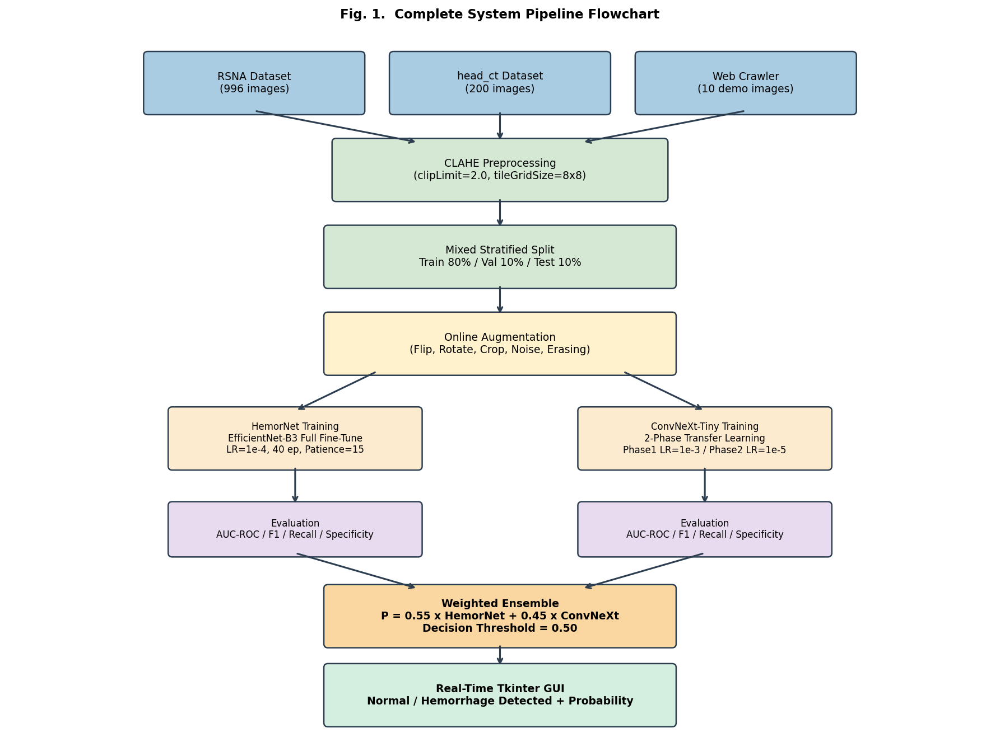
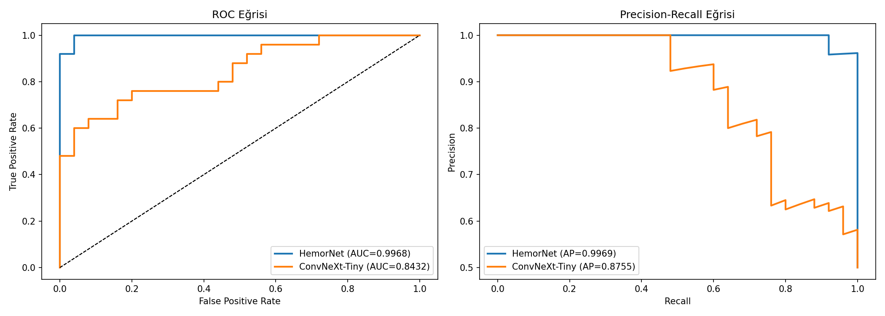
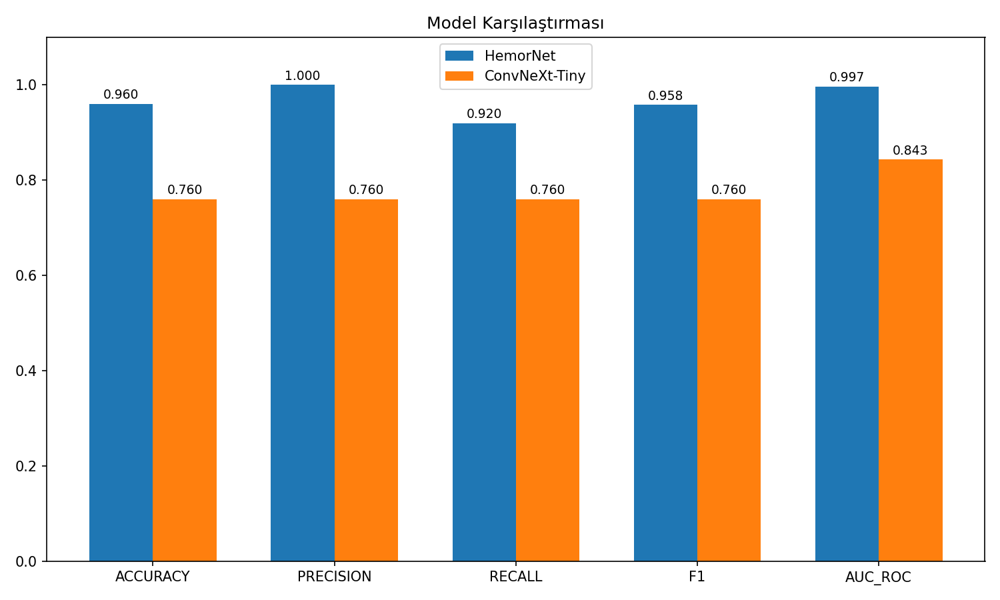
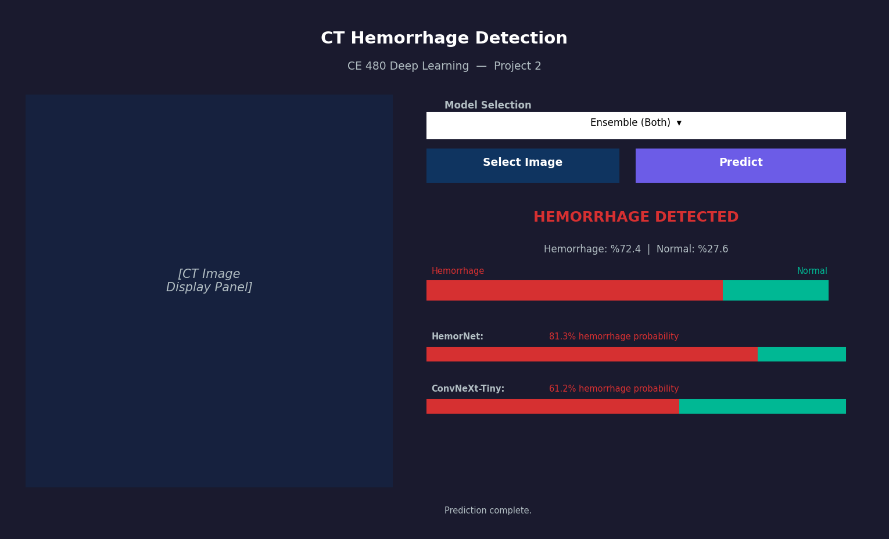

# Head CT Intracranial Hemorrhage Detection

[](https://github.com/Uguravsar75/Hemorrhage-Detection/actions/workflows/ci.yml)
[](https://www.python.org/)
[](https://pytorch.org/)
[](LICENSE)

**CE 480 Deep Learning — Project 2**  
Deep learning-based binary classification (`Normal` vs. `Hemorrhage`) of axial brain CT scans using an ensemble of **HemorNet (EfficientNet-B3)** and **ConvNeXt-Tiny**, complete with CT-specific preprocessing (CLAHE), custom medical data augmentations, Test-Time Augmentation (TTA), and a Tkinter desktop GUI.



---

## Project Structure

```text
├── main.py                      # Main CLI entry point (check, train, evaluate, hp_search, gui, all)
├── requirements.txt             # Python dependencies
├── app/
│   └── app.py                   # Tkinter desktop GUI application
├── src/
│   ├── data_preparation.py      # CLAHE preprocessing, dataset splitting, CT-specific augmentations
│   ├── train.py                 # Training loops, SmoothBCE loss, Warmup+Cosine scheduler, EarlyStopping
│   ├── evaluate.py              # Threshold optimization, metrics computation, ROC/PR/CM plotting
│   ├── inference.py             # Test-Time Augmentation (TTA) & weighted ensemble prediction
│   ├── hyperparameter_tuning.py # Manual Grid Search & Optuna Bayesian hyperparameter search
│   ├── web_crawler.py           # Wikimedia Commons CT image crawler
│   └── models/
│       ├── custom_cnn.py        # HemorNet (EfficientNet-B0/B3 backbone + custom classifier + CBAM)
│       └── pretrained_cnn.py    # ConvNeXt-Tiny two-phase transfer learning classifier
├── data/
│   ├── README.md                # Dataset setup instructions
│   ├── raw/
│   │   ├── head_ct/             # Primary Head CT dataset (labels.csv tracked; raw PNGs ignored)
│   │   └── rsna/                # RSNA Intracranial Hemorrhage subset (ignored in git)
│   └── web_crawled/             # External test CT scans crawled from Wikimedia Commons
├── saved_models/
│   ├── README.md                # Pretrained weights download & setup instructions
│   ├── hemornet_v5_best.pth     # Trained HemorNet (EfficientNet-B3) weights (via Releases)
│   ├── convnext_best.pth        # Trained ConvNeXt-Tiny weights (via Releases)
│   └── ensemble_config.json     # Ensemble weights and decision threshold
├── results/
│   ├── metrics/                 # JSON evaluation metrics and training history logs
│   └── plots/                   # ROC, PR, Confusion Matrix, training curves, and GUI screenshots
├── tests/
│   └── test_pipeline.py         # Automated unit tests for preprocessing, models, and TTA
└── LICENSE                      # MIT License
```

---

## Methodology & Architecture

1. **Preprocessing (`src/data_preparation.py`):**
   - 16-bit/8-bit grayscale normalization to `[0, 255]`.
   - **CLAHE** (`clipLimit=2.0, tileGridSize=(8,8)`) for local contrast enhancement of intracranial tissue and hemorrhage regions.
   - Lanczos resizing to `224×224` and 3-channel RGB conversion.
2. **CT-Specific Data Augmentation:**
   - Geometric & intensity transforms: `RandomHorizontalFlip`, `RandomVerticalFlip`, `RandomRotation(20°)`, `RandomAffine`, `RandomResizedCrop`, `ColorJitter`, `RandomErasing`.
   - Custom medical transforms: `AddGaussianNoise` (scanner noise simulation), `RandomGamma` (multi-scanner contrast variation), and `RandomElasticDeformation` (anatomical tissue variation).
3. **Models (`src/models/`):**
   - **HemorNet (`EfficientNet-B3`):** Pretrained feature extractor + custom `Dropout -> Linear(1536, 256) -> SiLU -> Dropout -> Linear(256, 1)` head.
   - **ConvNeXt-Tiny (`ConvNeXtClassifier`):** Two-phase fine-tuning (Phase 1: frozen backbone, classifier head warmup; Phase 2: unfreezing last 2 stages with low learning rate `1e-5`).
4. **Inference (`src/inference.py`):**
   - **Test-Time Augmentation (TTA):** Averages predictions across 8 augmented views per CT image.
   - **Weighted Ensemble:** Combines `HemorNet` (`0.55`) and `ConvNeXt-Tiny` (`0.45`) probabilities.

---

## Experimental Results

| Model | AUC-ROC | F1-Score | Recall (Sensitivity) | Precision | Specificity | Accuracy |
| :--- | :---: | :---: | :---: | :---: | :---: | :---: |
| **HemorNet v5 (EfficientNet-B3)** | **0.8653** | **0.8092** | **0.8833** | 0.7465 | 0.7000 | **0.7917** |
| **ConvNeXt-Tiny** | 0.8432 | 0.7600 | 0.7600 | **0.7600** | **0.7600** | 0.7600 |

<p align="center">
  
  
</p>

---

## Installation & Usage

### 1. Install Dependencies
```bash
pip install -r requirements.txt
```

### 2. Download Pretrained Weights & Datasets
Because model checkpoints (`convnext_best.pth` — 108 MB, `hemornet_v5_best.pth` — 43 MB) and raw CT datasets (~253 MB) are large binary assets, they are excluded from git history via `.gitignore`:
- **Model Weights:** Download `hemornet_v5_best.pth` and `convnext_best.pth` from the repository **Releases** page and place them in [`saved_models/`](saved_models/README.md).
- **Datasets:** For training or full evaluation from scratch, see [`data/README.md`](data/README.md). (Sample test images in `data/web_crawled/` are already included in the repo for quick GUI testing.)

### 3. Run Modes
```bash
# Check dataset and trained model files
python main.py --mode check

# Launch the desktop GUI application
python main.py --mode gui

# Evaluate trained models and generate plots in results/plots/
python main.py --mode evaluate

# Run hyperparameter optimization (Grid Search + Optuna)
python main.py --mode hp_search

# Train models from scratch
python main.py --mode train
```

### Desktop GUI (`app/app.py`)


